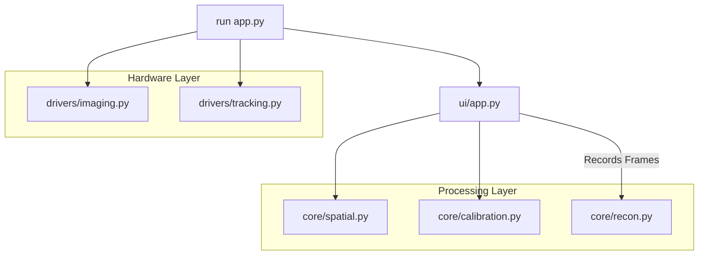

# Kaneko Lab - 3D Ultrasound Volume Reconstruction from 2D Slices Application
## Project Structure 

## core/
*Responsible for the mathematical heavy-lifting and spatial logic.*
* **`spatial.py`**: Coordinate system transformations and 4x4 matrix math.
* **`calibration.py`**: Logic for needle pivot calibration and Probe-to-Image (P2I) registration.
* **`recon.py`**: Algorithms for 3D volume reconstruction from tracked 2D slices.

## drivers/
*The hardware abstraction layer.*
* **`tracking.py`**: Wrapper for the NatNet (OptiTrack) client to fetch rigid body poses.
* **`imaging.py`**: Wrapper for the Clarius SDK (`pyclariuscast`) to handle the ultrasound stream.

## ui/
*The presentation and user interaction layer.*
* **`app.py`**: Manages Napari viewers, image layers, and real-time contrast/rendering settings.
* **`widgets.py`**: Custom Qt buttons and controls for triggering calibration, recording, and volume reconstruction.

## Additional Notes 

1. Clarius firmware is 12.2.1.
   
2. Cast Binary Release used is 12.2.0 (for Mac Intel core)
   
3. dependencies include: pyclariuscast.so, libcast.dylib

## Acknowledgements 

Thank you to Dr. Naoki Kaneko for providing the resources and support to complete this project. 

