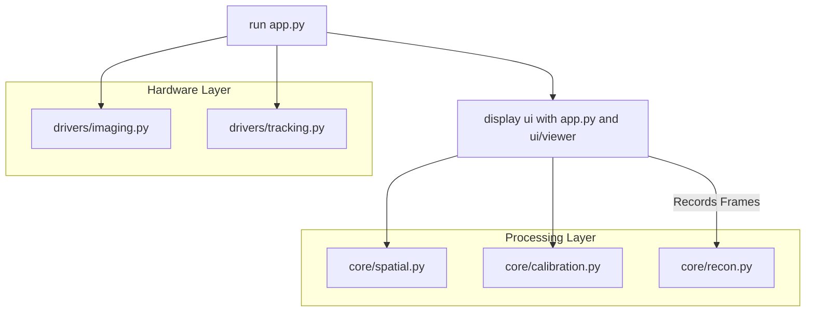

# Kaneko Lab - 3D Ultrasound Volume Reconstruction from 2D Slices Application

## Steps  
1. First, display Clarius Ultrasound data by connecting a device to the Probe's Wifi using the Clarius app. Ensure that "IMU" under the "Research" section is enabled. Adjust image Gain, display depth, and other features as needed. 
2. Connect the computer to the Probe's Wifi. Ensure that there are no active VPN connections, as this interferes with the connection made to the scanner.
3. Download the Cast Binary Release and add it to the project. In `drivers/imaging.py`, change the file path as necessary. Ensure that the Cast Binary Release version matches the software version of the Clarius app used.
4. Open Motive (the softwaer for the OptiTrack system). Calibrate the space and set the ground plane. Ensure that 2 Rigid Bodies (Assets) are made. One should be named "Ultrasound" and the other named "Needle". Under "Asset Properties", "Ultrasound" Streaming ID should be 0 and "Needle" Streaming ID should be 1. 
5. Run the file `app.py`.
6. Adjust values (i.e. opacity of reconstructed volume) as necessary. 

## Project Structure 

## core/
*Responsible for the mathematical heavy-lifting and spatial logic.*
* **`spatial.py`**: Coordinate system transformations and 4x4 matrix math.
* **`calibration.py`**: Logic for needle pivot calibration and Probe-to-Image (P2I) registration.
* **`recon.py`**: Algorithms for 3D volume reconstruction from tracked 2D slices.

## drivers/
*The hardware abstraction layer.*
* **`tracking.py`**: Wrapper for the NatNet (OptiTrack) client to fetch rigid body poses.
* **`imaging.py`**: Wrapper for the Clarius SDK (`pyclariuscast`) to handle the ultrasound stream.

## ui/
*The presentation and user interaction layer.*
* **`app.py`**: Manages Napari viewers, image layers, and real-time contrast/rendering settings.
* **`widgets.py`**: Custom Qt buttons and controls for triggering calibration, recording, and volume reconstruction.

## Additional Notes 

1. Clarius firmware is 12.2.1.
   
2. Cast Binary Release used is 12.2.0 (for Mac Intel core, same for Windows equivalent) 
   
3. dependencies include: pyclariuscast.so, libcast.dylib (for Mac)

## Acknowledgements 

Thank you to Dr. Naoki Kaneko (David Geffen School of Medicine, Department of Radiological Sciences) for providing the resources and support to complete this project and Mingda He (B.S. Congnitive Science, 2023) for developing the code for volume reconstruction and calibration. 

