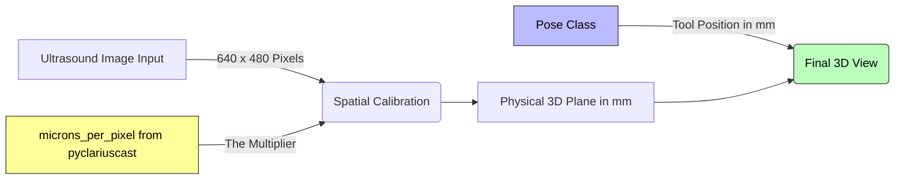

# imaging.py

>**Overview:** Bridges the Clarius Cast API and Python processing pipeline / Napari visualization. Uses the **Singleton State Pattern**, where a global `STATE` object holds the most recent ultrasound frame and metadata. 

**Note:** The public API functions were built using the `pyclariuscast` library and Clarius Cast API documentation as a reference. 

## Classes 

| Class Name | Logic Summary | 
| :--- | :--- | 
| `UltrasoundImage` | Configuration for U/S image shape and noise masking. | 
| `UltrasoundState` | Used to make the global `STATE` object. Has Thread Lock implementation to ensure that the hardware can write a new image while the UI thread is still reading the old one without causing memory corruption. | 

## Functions 

| Function Name | Input | Output | Logic Summary | 
| :--- | :--- | :--- | :--- | 
| `start_ultrasound_stream`, `stop_ultrasound_stream` | `ip`, `port` | `None` | Connects to / Disconnects the Clarius Probe via Wifi-Direct. | 
| `get_new_us_frame` | `None` | `timestamp`, `image`, `microns_per_pixel` | Returns a thread-safe copy of the latest image and its spatial calibration. |
| `get_latest_imu` | `None` | `List` | Returns the contents of the IMU buffer (orientation and acceleration data). | 

## Additional Information 

1. IP address and Port are obtained from the Clarius App when the probe is connected. For "Research" Mode, the Port address is typically 5828. 

2. Dependencies include `libcast.dylib` and the `pyclariuscast.so` (for Mac). These dependencies **must** be bundled together (i.e. part of the same release version) and match the Python version used for the project. 

3. Make sure to **enable IMU** in the Clarius App to receive IMU data for the processing pipeline. 

### Calibration Parameters 

1. **Axial Calibration:** Vertical distance along the U/S beam. 
2. **Lateral Calibration:** Horizontal distance across the probe face. 

`micronsPerPixel` (part of a Clarius callback) is treated as a single value. This assumes pixels are square-shaped, where veritcal and horizontal scaling are identical. 

### Connection to `Pose` object (in `structures.py`)

This diagram shows how two types of data (i.e. a **2D Digital Image** and **3D Tracking Coordinates**) are synchronized. 

