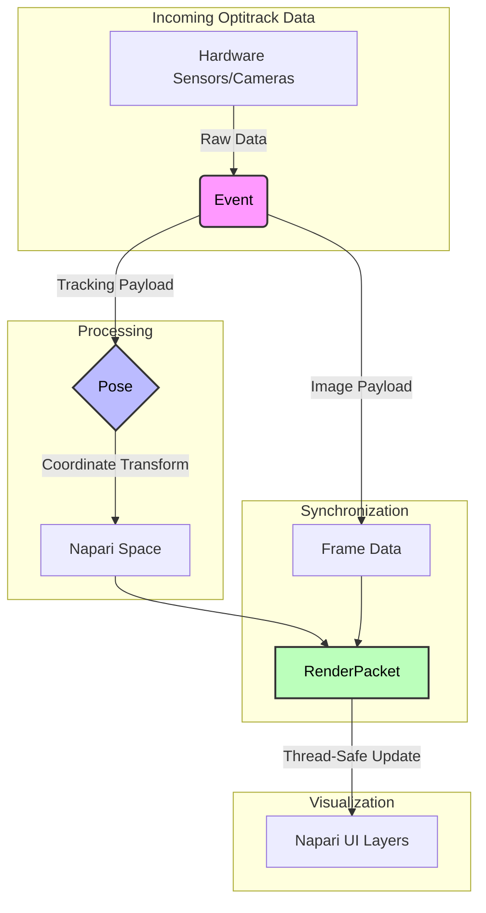

# structures.py

> **Overview:** The `Pose` Class handles the conversion between physical space (raw quaternions) and visualization space in Napari, with units of mm and a (z,y,x) coordinate system. 

## Classes 

| Class Name | Logic Summary | 
| :--- | :--- | 
| `Event` | Pairs a `payload` (i.e. raw image, tracking matrix) with a `timestamp` and `seq` (sequence) number. | 
| `RenderPacket` | A synchronization container. It ensures that the image `frame` matches the tracking `poses` at a given point in time. | 
| `Recording Buffer` | Prevents memory overflow. | 
| `Pose` | Stores 6 DoF data. Holds raw position and rotation data. Applies a correction for sensor offset and pre-computes Rotation objects for drawing directional arrows in the UI. | 

## Additional Information

### Pose Functions 

| Function Name | Input | Output | Logic Summary | 
| :--- | :--- | :--- | :--- | 
| `arrow` | `out` (optional numpy array), `length_mm` (optional float) | `numpy array` (1,2,3) | Calculates a 3D vector. Uses the tool's position as a starting point and projects a tip by applying the combined body and alignment rotations to a forward unit vector. | 
| `from_pos_rot` | `pos`, `quat`, `align_quat` (optional 4-vec) | `Pose` instance | Entry point for creating a Pose object from raw tracking data. | 

## Napari Convention 

Napari Vectors have Shape **(1,2,3)**: 

| Dimension | Value | Logic Summary | 
| :--- | :--- | :--- | 
| `1` | `N` vectors | One arrow per Pose tool. | 
| `2` | `N` points | Two points per arrow to indiciate direction and magnitude. | 
| `3` | `N` coordinates | Each point needs 3 coordinates. | 

### Data Flow

